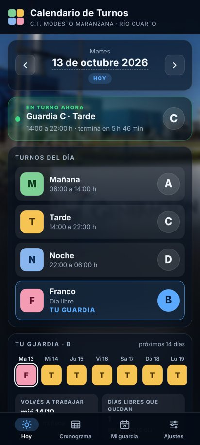
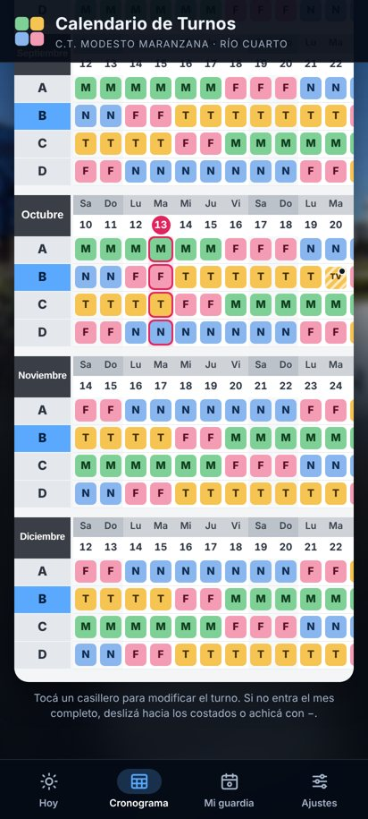
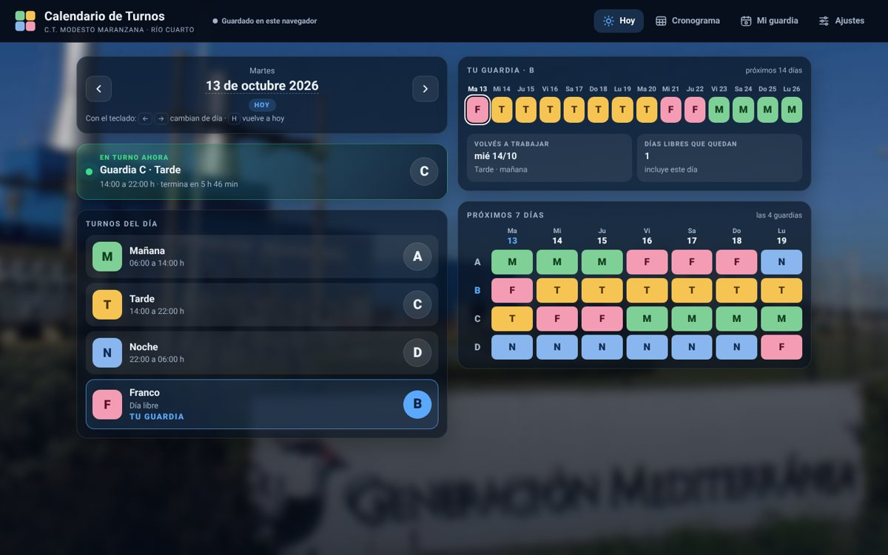
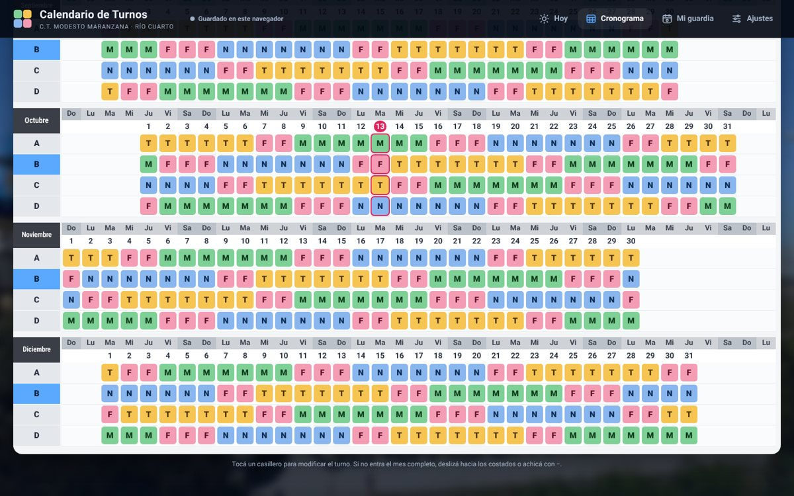

# Turnos CTMM — Control de cronograma de turnos rotativos

App para seguir el cronograma de turnos rotativos de las cuatro guardias (**A, B, C y D**) de la
**Central Termoeléctrica Modesto Maranzana** (Río Cuarto, Córdoba).

Está armada sobre la planilla *Calendario de Turnos* de la central: los meses en bloques, una fila por
guardia y cada día debajo de su día de la semana. Calcula el ciclo para cualquier año y permite
modificar días (cambios de turno, vacaciones, intercambios entre guardias).

Hay dos versiones que comparten el mismo código:

| | Versión | Dónde está |
|---|---|---|
| 📱 | **App Android** (APK, Android 7 o superior) | [`releases/TurnosCTMM-v1.1.apk`](releases/TurnosCTMM-v1.1.apk) |
| 💻 | **Versión web** (un solo archivo HTML, funciona sin conexión) | [`web/index.html`](web/index.html) |

## Capturas

| Celular: Hoy | Celular: Cronograma | PC: Hoy |
|---|---|---|
|  |  |  |



## Funciones

- **Hoy**: qué guardia está de mañana, tarde, noche y franco; quién está en turno en este momento y
  cuánto le falta; tus próximos 14 días, tu próximo franco y una tabla de las 4 guardias para los próximos 7 días.
- **Cronograma**: réplica de la planilla, con selector de año ("Actualizar año"), salto por mes, zoom y
  el día de hoy marcado.
- **Mi guardia**: calendario mensual de una guardia con cantidad de mañanas, tardes, noches, francos y
  horas trabajadas. Se puede compartir el mes como texto.
- **Modificar un día**: tocando cualquier casillero se puede cambiar el turno (M, T, N, F), cargar
  vacaciones (MV, TV, NV, FV) en un día o en un rango, intercambiar el turno con otra guardia y agregar
  una nota. Los días modificados quedan marcados con un punto.
- **Ajustes**: tu guardia, horarios de cada turno, patrón de rotación (avisa si algún turno queda sin
  cobertura), inicio de ciclo de cada guardia y respaldo para exportar/importar los cambios.
- En la PC: navegación arriba, el mes completo a la vista y atajos de teclado (← → cambian de día o de mes,
  H vuelve a hoy, Esc cierra la ventana de edición).

## Instalar la app en el celular

1. Descargá [`releases/TurnosCTMM-v1.1.apk`](releases/TurnosCTMM-v1.1.apk) en el teléfono.
2. Abrilo y aceptá *permitir instalar apps de esta fuente*. Android avisa que no viene de Play Store; es normal.
3. Si ya tenías la v1.0, la v1.1 se instala encima y conserva tus cambios.

## Usar la versión web

Abrí `web/index.html` en cualquier navegador (también funciona sin internet). Para tenerla publicada
en una dirección web podés activar **GitHub Pages** en *Settings → Pages* con la carpeta raíz de `main`;
queda en `https://<usuario>.github.io/<repositorio>/web/`.

La app y la web guardan los datos cada una en su lugar (el celular y el navegador). Para pasar los cambios
de una a otra: **Ajustes → Exportar respaldo** en una e **Importar respaldo** en la otra.

## Cómo se calcula el cronograma

El patrón de la planilla es un ciclo fijo de **28 días**:

| Días del ciclo | 1–7 | 8–9 | 10–16 | 17–18 | 19–25 | 26–28 |
|---|---|---|---|---|---|---|
| Turno | Noche | Franco | Tarde | Franco | Mañana | Franco |

Cada guardia arranca el ciclo con 7 días de diferencia (fecha del primer día de noche):

| Guardia | C | B | D | A |
|---|---|---|---|---|
| Inicio de ciclo | 06/07/2026 | 13/07/2026 | 20/07/2026 | 29/06/2026 |

Así, cada día hay exactamente una guardia de mañana, una de tarde, una de noche y una de franco:

```
turno(guardia, fecha) = patrón[(fecha − inicio_guardia) mod 28]
```

Sobre ese cálculo se aplican los días modificados (`fecha|guardia → código`). El patrón, los inicios de
ciclo y los horarios (por defecto 06–14, 14–22 y 22–06) se pueden cambiar desde Ajustes.

## Estructura del proyecto

```
src/app.html              Fuente única de la app (HTML + CSS + JavaScript, sin dependencias)
android/                  Contenedor Android
  AndroidManifest.xml
  src/ar/ctmm/turnos/     MainActivity (WebView), Bridge (guarda datos y comparte), LinkClient, ShareTask
  res/                    Ícono y tema
  assets/                 index.html generado + fondos difuminados de la central
web/index.html            Versión web generada (un solo archivo, fondo embebido)
tools/build_pages.py      Genera android/assets/index.html y web/index.html desde src/app.html
tools/make_bg.py          Genera los fondos difuminados a partir de una foto de la central
tools/make_icon.py        Genera el ícono
build.sh                  Compila y firma el APK sin Gradle
releases/                 APK listo para instalar
docs/capturas/            Capturas de pantalla
```

## Compilar

Requisitos: JDK 17 o superior, Android SDK (build-tools y `platforms/android-34`) y Python 3.

```bash
# Solo regenerar las páginas (después de editar src/app.html)
python3 tools/build_pages.py

# Compilar el APK (subí VCODE en cada versión nueva)
export KEYSTORE=/ruta/a/keystore.jks KS_PASS='contraseña'
VCODE=3 VNAME=1.2 ./build.sh        # → build/TurnosCTMM-v1.2.apk
```

> **La clave de firma (`keystore.jks`) no está en el repositorio a propósito.** Guardala aparte: una
> versión nueva solo se instala encima de la anterior (sin perder los datos) si se firma con la misma clave.

## Datos y respaldo

- App Android: se guardan en el teléfono (SharedPreferences).
- Web: se guardan en el navegador (localStorage).
- El respaldo es un JSON con el patrón, los inicios de ciclo, los horarios, tu guardia y los días modificados:

```json
{"app":"turnos-ctmm","v":1,"pattern":"NNNNNNNFFTTTTTTTFFMMMMMMMFFF",
 "anchors":{"A":"2026-06-29","B":"2026-07-13","C":"2026-07-06","D":"2026-07-20"},
 "hours":{"M":["06:00","14:00"],"T":["14:00","22:00"],"N":["22:00","06:00"]},
 "myCrew":"B","overrides":{"2026-10-20|B":{"code":"TV","note":"Vacaciones"}}}
```
